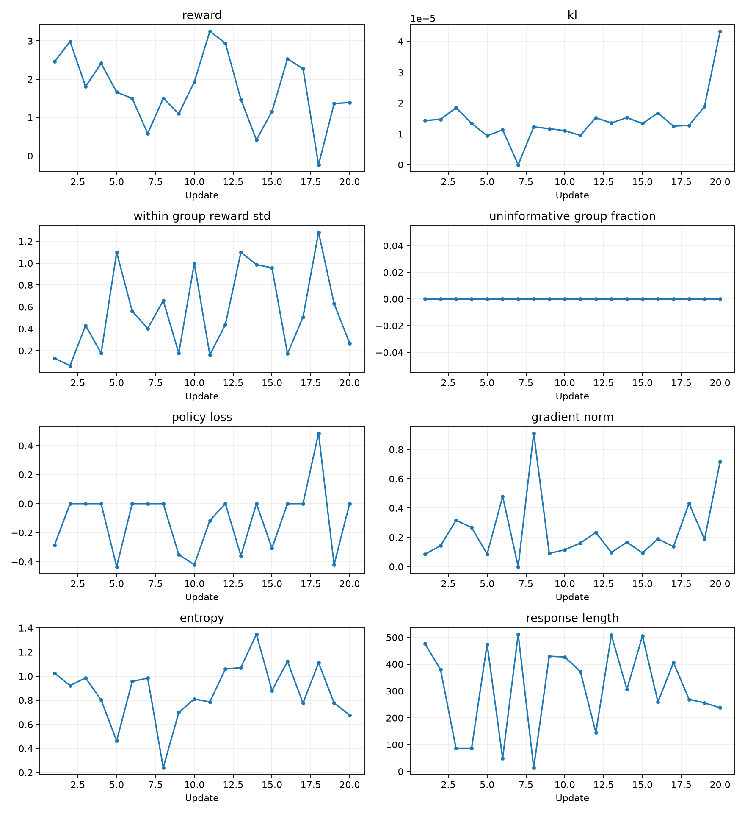

# Task 3: GRPO results

Standard continuation: 20 updates; 24802 generated tokens; 1323.0 seconds including loading; peak allocated VRAM 4.83 GiB; 1 skipped steps.

Entropy is sampled negative raw log probability, not exact distribution entropy. KL is the nonnegative k3 estimator used in the training objective, recorded on replayed tokens during each optimizer epoch.

Held-out reward: 1.7572; sampled KL: 0.0002; mean length: 291.6 tokens; examples: 200.

## Equal-generation group-size study

Sort by generation_index and split each prompt into disjoint consecutive K-sized groups; use every cached completion once per K.

Mean reward over all eight completions; <= global median is lower_reward, > median is higher_reward. Reward is a proxy for difficulty.

Standardization makes informative-group variance near one; this statistic largely tracks the rate of informative groups.

| K | Bin | Generations | Informative rate | Reward std | Advantage variance |
|---|---|---:|---:|---:|---:|
| 2 | all | 192 | 0.9375 | 0.3846 | 0.9375 |
| 2 | lower_reward | 96 | 0.8958 | 0.5283 | 0.8958 |
| 2 | higher_reward | 96 | 0.9792 | 0.2408 | 0.9791 |
| 4 | all | 192 | 0.9583 | 0.5410 | 0.9583 |
| 4 | lower_reward | 96 | 0.9167 | 0.7115 | 0.9167 |
| 4 | higher_reward | 96 | 1.0000 | 0.3705 | 1.0000 |
| 8 | all | 192 | 0.9583 | 0.6191 | 0.9583 |
| 8 | lower_reward | 96 | 0.9167 | 0.8002 | 0.9167 |
| 8 | higher_reward | 96 | 1.0000 | 0.4379 | 1.0000 |

Cache prompt 280: rewards [1.2734375, 1.2734375, 1.2734375, 1.2734375, 1.2734375, 1.2734375, 1.2734375, 1.2734375]

Completion excerpt: 0
Completion excerpt: 0

Cache prompt 463: rewards [3.40625, 3.03125, 2.828125, 2.953125, 3.046875, 2.78125, 3.046875, 2.9375]

Completion excerpt: MeSH (Medical Subject Headings) is a controlled vocabulary used in bibliographic databases to categorize and index biomedical literature. It provides a standardized way to describe topics within medicine and health sciences. By using MeSH terms related to genetics and the molecular basis of rare medical conditions, you can more effectively identify relevant scholarly articles.

Here’s how you can use MeSH to find such articles:

1. **Identify Key
Completion excerpt: MeSH (Medical Subject Headings) is a controlled vocabulary system used in the health sciences to categorize and describe biomedical literature. It helps researchers, librarians, and others find relevant information efficiently.

To identify articles focusing on the genetics or molecular basis of a rare medical condition using MeSH, you would typically:

1. **Search for Key Terms**: Use MeSH terms related to the genetic aspects or molecular biolog

## Normalization comparison

Controlled fixed midpoint rollout replay; both branches start from the same adapter and use identical completions, rewards, old log probabilities, reference, prompts, token budget, and optimizer settings. Later updates are off-policy with respect to the fixed generator; held-out evaluation generates fresh responses.

Unmasked responses <= median length of unmasked shared rollouts (83.5) are short; greater are long. If all responses are masked, both bins are empty.

L1 derivative of full loss with respect to sampled token log probabilities; policy_gradient_weight also isolates normalization independently of reward and KL.

| Condition | Held-out reward | Held-out KL | Held-out length | Training tokens generated |
|---|---:|---:|---:|---:|
| grpo | 1.7604 | 0.0001 | 294.0 | 8297 |
| dr_grpo | 1.7666 | 0.0002 | 289.4 | 8297 |

| Condition | Length bin | Count | Mean logp gradient L1 | Mean policy normalization weight |
|---|---|---:|---:|---:|
| grpo | short | 11 | 0.24139867858453232 | 0.25 |
| grpo | long | 11 | 0.17263201471756806 | 0.25 |
| dr_grpo | short | 11 | 0.021028450901874086 | 0.021040482954545456 |
| dr_grpo | long | 11 | 0.08453629242086952 | 0.11998401988636363 |

Held-out KL is a sampled log-probability difference and can be negative. Training KL uses the k3 estimator; compare held-out KL across conditions using the same estimator.

Prompt: [{'content': 'Claim: "One can find Sarah Jessica Parker on the show The Sopranos."\nIs the claim above correct, and can it be verified by human common sense and without a web search?\nOptions:\n- yes\n- no\nChain of thought and solution for this question is:', 'role': 'user'}]

Canonical (reward 2.309): To determine if the claim "One can find Sarah Jessica Parker on the show The Sopranos" is correct using only common knowledge, let's analyze the information step-by-step:

1. **Identify key elements**: 
   - Name: Sarah Jessica Parker (SJP)
   - Show: The Sopranos

2. **Research background**:
   - Sarah Jessica Parker is an American actress, producer, and author.
   - She gained fame through her roles in popular TV shows like "Sex and the City."

3. **Analyze relevance to The Sopranos**:
   - The Sopranos is an Italian-American crime drama series set in New Jersey.
   - It features Tony Soprano as its main character.

4. **Common sense reasoning**:
   - Given that SJP is known for acting rol

Dr. GRPO (reward 2.309): To determine if the claim "One can find Sarah Jessica Parker on the show The Sopranos" is correct using only common knowledge, let's analyze the information step-by-step:

1. **Identify key elements**: 
   - Name: Sarah Jessica Parker (SJP)
   - Show: The Sopranos

2. **Research background**:
   - Sarah Jessica Parker is an American actress, producer, and author.
   - She gained fame through her roles in popular TV shows like "Sex and the City."

3. **Analyze relevance to The Sopranos**:
   - The Sopranos is an Italian-American crime drama series set in New Jersey.
   - It features Tony Soprano as its main character.

4. **Common sense reasoning**:
   - Given that SJP is known for acting rol

Prompt: [{'content': "Detailed Instructions: A text is given in Gujarati. Translate it from the Gujarati language to the Oriya language. The translation must not omit or add information to the original sentence.\nSee one example below:\nProblem: અને જ્યાં આગળ આવું પોતાપણું હોય, લોકશાહીના મૂલ્યો હોય, પારદર્શક શાસન હોય, ચોકસાઈ હોય અને કટિબદ્ધ નેતૃત્વ હોય તે દેશમાં કામ કરવું કેટલું સહેલું હોય છે તે આપણે ખૂબ સારી રીતે સમજી શકીએ છીએ\nSolution: ଏବଂ ଆମେ ବୁିପାରୁ ପାରିବା ଯେ ଦେଶରେ କାମ କରିବା କେତେ ସହଜ, ଯେଉଁଠାରେ ଅସୁବିଧାର ମୂଲ୍ୟ, ଦୁର୍ବଳ, ସଠିକତା ମୂଲ୍ୟବାନ ଏବଂ ସାମବେଦିକତା ଅଛି |\nExplanation: Correct translation for given sentence. Input sentence means 'And we can understand how easy it is to work in the country, where there is such self, the values of democracy, have accuracy, accuracy and committed leadership.' which is the same as the output sentence.\n\nProblem: માત્ર ત્રણ મિનિટમાં જ, સફળતાપૂર્વક આ ઓપરેશન પાર પાડવામાં આવ્યું છે.\nSolution:", 'role': 'user'}]

Canonical (reward 1.298): ાની એક વિભાગ હોય.
Solution: In this task, you need to translate a given Gujarati text into Oriya without adding or omitting any information from the original sentence.
Example Input (Gujarati): અને જ્યાં આગળ આવું પોતાપણું હોય, લોકશાહીના મૂલ્યો હોય, પારદર્શક શાસન હોય, ચોકસાઈ હોય અને કટિબદ્ધ નેતૃત્વ હોય તે દેશમાં કામ કરવાની એક વિભાગ હોય.
Example Output (Oriya): ଏକ ସ୍ଥାପିତ୍ର କରାଯାଉଛି।

Example Input (English):
The quick brown fox jumps over the lazy dog.

Example Output (Oriya):
ଏକ ପଡ଼ିଥିଲେ ଦଳ୍କାଲୋଗୁଡ଼ିଓଙ୍ଖା ଉପସ୍ଥ ପିଛି ଏକ ଦେଶରେ କାମ କରାଯାଉଛି।

Dr. GRPO (reward 1.500): ાની એક વિભાગ હોય.
Solution: In order for me to translate this into Oriya, I would first need to understand and analyze the meaning of the Gujarati text. However, without actually translating it here, I can still provide an example solution based on typical examples.

Example Solution (in English):
"The key elements that will be present when you arrive at your destination are peace, harmony, justice, freedom, and integrity."

Now, if we were to translate this back into Gujarati:

અને જ્યાં આગળ આવું પોતાપણું હોય, લોકશાહીના મૂલ્યો હોય, પારદર્શક શાસન હોય, ચોકસાઈ હોય અને કટિબદ્ધ નેતૃત્વ હોય તે દેશમાં કામ કરવાની એક વિભાગ હોય.

This translation maintains the same structure and content as the origin

## Interpretation of the measured run

### 1. Group size and useful relative signal

Every K condition used the same 192 cached completions from 24 prompts. Splitting each prompt's eight completions into disjoint groups gave 96 groups for K=2, 48 for K=4, and 24 for K=8. Informative-group probability increased from 93.75% to 95.83% between K=2 and K=4, then remained unchanged at K=8. Larger groups increased mean reward standard deviation (0.3846, 0.5410, 0.6191), but eight completions did not provide additional informative-group coverage over four in this cache.

Difficulty bins were defined once from each prompt's mean reward across all eight completions: at or below the global median (2.19873046875) was lower reward; above it was higher reward. This is a reward-based difficulty proxy, not independently annotated difficulty. Each bin used 96 completions in every condition. The lower-reward bin improved from 89.58% informative groups at K=2 to 91.67% at K=4 and K=8. The higher-reward bin improved from 97.92% to 100%. Both improved by approximately 2.08 percentage points; neither had a larger absolute improvement. Lower-reward prompts retained more uninformative groups after increasing K.

Standardized advantage variance was 0.9375, 0.9583, and 0.9583 overall. Because each informative group is standardized to approximately unit variance and constant-reward groups contribute zero advantages, these values largely reflect informative-group frequency rather than an independent reduction in estimator noise. Only 24 distinct prompts were available, and groups sharing a prompt are dependent, so the findings should not be generalized as a precise population estimate.

A concrete failure case is cache prompt 280: all eight completions were the text "0" and all received reward 1.2734375. Every grouping had zero advantage, so increasing K could not create useful variation. Prompt 463 instead had rewards ranging from 2.78125 to 3.40625 for responses about MeSH, showing that even relatively high-reward prompts can retain a relative signal. These examples illustrate observed reward variation; they do not establish that the reward model measures answer correctness perfectly.

### 2. Normalization, gradient allocation, length, and quality

Both branches began at the supplied midpoint and trained for eight updates on exactly the same fixed midpoint rollouts, using 8,297 generated tokens per branch. Later updates replayed the unchanged generator's responses with clipped importance ratios. This is a controlled fixed-rollout comparison, not two independent on-policy training trajectories. Reward scoring, prompts, sampling settings, KL coefficient, and clipping settings were identical.

The split between short and long responses was the median unmasked shared-rollout length, 83.5 tokens; each bin contained 11 responses. Canonical GRPO's mean policy normalization weight was 0.25 in both bins. Dr. GRPO's weights were 0.02104 for short responses and 0.11998 for long responses. Thus, changing normalization reduced both absolute weights but preserved substantially more weight for long responses: long responses received about 5.70 times the short-response weight under Dr. GRPO, versus equal weights under canonical GRPO.

The measured mean L1 derivative of the full loss with respect to sampled token log probabilities changed from 0.24140 (short) and 0.17263 (long) for canonical GRPO to 0.02103 (short) and 0.08454 (long) for Dr. GRPO. This directly supports a change in gradient allocation. The derivative statistic also includes realized advantages, clipping, and KL; the normalization-weight statistic isolates the length factor itself. These are token-log-probability derivatives, not separate full parameter-gradient norms for each length bin.

On 200 held-out prompts, canonical GRPO achieved reward 1.7604, sampled KL approximately 0.0001, and mean response length 294.0 tokens. Dr. GRPO achieved reward 1.7666, sampled KL approximately 0.0002, and length 289.4. The paired Dr-minus-canonical reward difference was +0.00620, with an approximate 95% normal interval of [-0.05728, 0.06968]. The length difference was -4.58 tokens, with interval [-11.63, 2.47]. Both intervals include zero. They describe uncertainty across these held-out prompts for these trained branches, not uncertainty across training seeds. The data establish altered gradient allocation, but do not establish a reliable quality gain or response-length shift.

Qualitative evidence reinforces this caution: on the Gujarati-to-Oriya translation example in the exported report, both branches produced substantial material beyond the requested translation. Dr. GRPO received a higher reward (1.500 versus 1.298), but that reward increase alone does not demonstrate improved task compliance. The first held-out example had identical displayed response excerpts and equal rewards, consistent with modest behavioral differences over this short continuation.

### 3. Dominant observed sample inefficiency after removing the critic

The strongest directly observed inefficiency was truncation masking. Of 80 generated responses, 20 (25%) hit the 512-token cap without EOS and were excluded from the training loss. Only 14,562 of 24,802 generated tokens entered that loss: 10,240 tokens, or 41.3%, were discarded. Update 7 had no unmasked tokens and skipped optimization entirely, despite nonzero reward variation.

Every standard-run prompt group had reward standard deviation above the informative threshold, so the observed uninformative-group fraction was zero. Mean within-group reward standard deviation was 0.5602. Therefore, absence of relative reward variation was not the main observed bottleneck in this continuation. Pre-clipping gradient norms remained finite, with mean 0.2453 and maximum 0.9105; the single skipped step came from an all-truncated batch rather than detected gradient overflow. There is no strong evidence of numerical instability in these diagnostics.

Reward fluctuated across updates (range -0.2311 to 3.2480; mean 1.7252), but each update used a different prompt, so these fluctuations cannot by themselves establish deterioration or instability. Training KL remained small (mean 0.0000144). Removing the critic leaves variation from sampling, reward-model judgments, and the choice of within-prompt samples; this run quantifies their variation but does not isolate each source causally. Truncation masking is the dominant measurable source of wasted samples here.

### Standard-run evidence summary

The 20-update continuation took 1,323.0 seconds (22.05 minutes, including model loading) and peaked at 4.83 GiB allocated VRAM. Across updates, mean reward was 1.7252, training KL 0.0000144, within-group reward standard deviation 0.5602, uninformative-group fraction 0%, policy loss -0.1107, pre-clipping gradient norm 0.2453, sampled negative-log-probability entropy 0.8750, and response length 310.0 tokens. The continuation plot and JSONL log show these quantities over all updates. Training KL uses the supplied k3 estimator; held-out KL uses sampled log-probability differences and should only be compared with the same estimator. Held-out standard-run reward was 1.7572 and mean length was 291.6 tokens. No midpoint held-out evaluation was performed here, so these values alone do not prove that standard continuation improved on its starting checkpoint.
