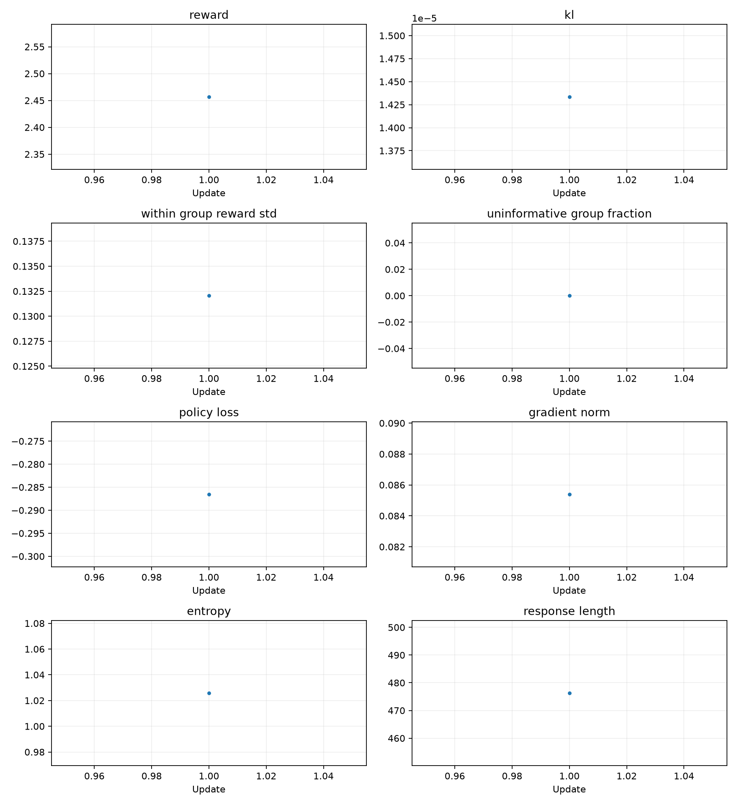

# Task 3: GRPO results

Standard continuation: 1 updates; 1905 generated tokens; 135.1 seconds including loading; peak allocated VRAM 6.91 GiB; 0 skipped steps.

Entropy is sampled negative raw log probability, not exact distribution entropy. KL is the nonnegative k3 estimator used in the training objective, recorded on replayed tokens during each optimizer epoch.

## Equal-generation group-size study

Sort by generation_index and split each prompt into disjoint consecutive K-sized groups; use every cached completion once per K.

Mean reward over all eight completions; <= global median is lower_reward, > median is higher_reward. Reward is a proxy for difficulty.

Standardization makes informative-group variance near one; this statistic largely tracks the rate of informative groups.

| K | Bin | Generations | Informative rate | Reward std | Advantage variance |
|---|---|---:|---:|---:|---:|
| 2 | all | 192 | 0.9375 | 0.3846 | 0.9375 |
| 2 | lower_reward | 96 | 0.8958 | 0.5283 | 0.8958 |
| 2 | higher_reward | 96 | 0.9792 | 0.2408 | 0.9791 |
| 4 | all | 192 | 0.9583 | 0.5410 | 0.9583 |
| 4 | lower_reward | 96 | 0.9167 | 0.7115 | 0.9167 |
| 4 | higher_reward | 96 | 1.0000 | 0.3705 | 1.0000 |
| 8 | all | 192 | 0.9583 | 0.6191 | 0.9583 |
| 8 | lower_reward | 96 | 0.9167 | 0.8002 | 0.9167 |
| 8 | higher_reward | 96 | 1.0000 | 0.4379 | 1.0000 |

Cache prompt 280: rewards [1.2734375, 1.2734375, 1.2734375, 1.2734375, 1.2734375, 1.2734375, 1.2734375, 1.2734375]

Completion excerpt: 0
Completion excerpt: 0

Cache prompt 463: rewards [3.40625, 3.03125, 2.828125, 2.953125, 3.046875, 2.78125, 3.046875, 2.9375]

Completion excerpt: MeSH (Medical Subject Headings) is a controlled vocabulary used in bibliographic databases to categorize and index biomedical literature. It provides a standardized way to describe topics within medicine and health sciences. By using MeSH terms related to genetics and the molecular basis of rare medical conditions, you can more effectively identify relevant scholarly articles.

Here’s how you can use MeSH to find such articles:

1. **Identify Key
Completion excerpt: MeSH (Medical Subject Headings) is a controlled vocabulary system used in the health sciences to categorize and describe biomedical literature. It helps researchers, librarians, and others find relevant information efficiently.

To identify articles focusing on the genetics or molecular basis of a rare medical condition using MeSH, you would typically:

1. **Search for Key Terms**: Use MeSH terms related to the genetic aspects or molecular biolog

## Normalization comparison

Controlled fixed midpoint rollout replay; both branches start from the same adapter and use identical completions, rewards, old log probabilities, reference, prompts, token budget, and optimizer settings. Later updates are off-policy with respect to the fixed generator; held-out evaluation generates fresh responses.

Unmasked responses <= shared-rollout median length (64.0) are short; greater are long.

L1 derivative of full loss with respect to sampled token log probabilities; policy_gradient_weight also isolates normalization independently of reward and KL.

| Condition | Held-out reward | Held-out KL | Held-out length | Training tokens generated |
|---|---:|---:|---:|---:|
| grpo | -0.1039 | 0.0001 | 64.0 | 128 |
| dr_grpo | -0.1039 | 0.0001 | 64.0 | 128 |

| Condition | Length bin | Count | Mean logp gradient L1 | Mean policy normalization weight |
|---|---|---:|---:|---:|
| grpo | short | 2 | 0.5000070035457611 | 0.5 |
| grpo | long | 0 | None | None |
| dr_grpo | short | 2 | 0.5000070035457611 | 0.5 |
| dr_grpo | long | 0 | None | None |

Held-out KL is a sampled log-probability difference and can be negative. Training KL uses the k3 estimator; compare held-out KL across conditions using the same estimator.

Prompt: [{'content': 'Claim: "One can find Sarah Jessica Parker on the show The Sopranos."\nIs the claim above correct, and can it be verified by human common sense and without a web search?\nOptions:\n- yes\n- no\nChain of thought and solution for this question is:', 'role': 'user'}]

Canonical (reward -0.104): To determine if the claim "One can find Sarah Jessica Parker on the show The Sopranos" is correct using only common knowledge, let's analyze the information step-by-step:

1. **Identify key elements**: 
   - Name: Sarah Jessica Parker (SJP)
   - Show: The Sop

Dr. GRPO (reward -0.104): To determine if the claim "One can find Sarah Jessica Parker on the show The Sopranos" is correct using only common knowledge, let's analyze the information step-by-step:

1. **Identify key elements**: 
   - Name: Sarah Jessica Parker (SJP)
   - Show: The Sop

## Interpretation to complete

Use these measurements to discuss which difficulty bins benefit from larger groups, whether normalization reallocates gradient magnitude and changes held-out length/quality, and whether low reward variation, truncated completions, noisy rewards, or numerical instability dominates the standard run.
